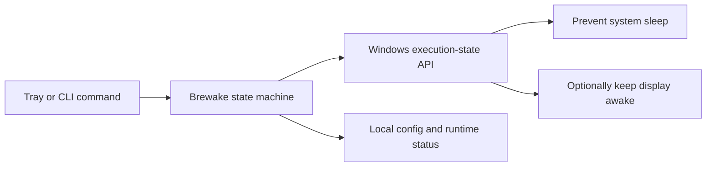

<div align="center">
  
  <h1>Brewake</h1>
  <p><strong>Keep your computer awake, simply.</strong></p>

  [](https://github.com/thanhbican/brewake/actions/workflows/ci.yml)
  [](https://github.com/thanhbican/brewake/releases/latest)
  [](LICENSE)
  [](https://www.rust-lang.org/)

  English · [Tiếng Việt](README.vi.md)
</div>

## About

Brewake is a tiny, native Windows tray utility that prevents sleep without changing your power plan. It is useful during long downloads, presentations, builds, remote sessions, or any task where the computer must stay available.

Brewake uses Windows' execution-state API—never fake key presses. It has no WebView, background service, account, network access, advertisements, analytics, elevation prompt, or telemetry.

## Highlights

| Feature | What it does |
| --- | --- |
| Native tray app | Left-click toggles Brewake; right-click opens all controls. |
| Flexible timers | Stay awake indefinitely or for 15 minutes to 8 hours. |
| Temporary pause | Pause for 15 minutes to 4 hours, then resume automatically. |
| Display control | Optionally keep both the computer and display awake. |
| Start with Windows | Uses the current user's startup registry entry; no admin rights. |
| CLI companion | Inspect and control the running app with `brewakectl`. |
| Resilient | Re-applies the request after power events and verifies API success. |
| Private by design | No network calls, telemetry, updater, or user tracking. |

## Download and run

1. Download `Brewake-<version>-windows-x64.zip` from [GitHub Releases](https://github.com/thanhbican/brewake/releases/latest).
2. Optionally verify it against the accompanying `.sha256` file.
3. Extract the archive and run `brewake.exe`.
4. Find the mug icon in the Windows notification area. Windows may place it under the `^` overflow button.

The archive contains:

- `brewake.exe` — tray application, with no console window.
- `brewakectl.exe` — optional command-line controller.
- `README.md` and `LICENSE`.

Current releases are not code-signed. Windows SmartScreen may show an “unrecognized app” warning; verify the checksum and download only from this repository. Signing is on the roadmap.

## Tray controls

- **Left-click:** toggle active/inactive.
- **Active:** keep the computer awake until manually disabled.
- **Active for:** keep awake for a selected duration.
- **Inactive for:** pause an active session, then resume it automatically.
- **Keep display awake:** also prevent the monitor from powering off.
- **Start with Windows:** launch Brewake for the current Windows user.
- **Show status:** display the current mode, deadline, and Windows API result.
- **About Brewake:** show version, privacy boundaries, repository, and license.
- **Exit:** release the power request and close cleanly.

## Command line

Keep `brewakectl.exe` beside `brewake.exe`, then use:

```powershell
brewakectl status
brewakectl status --json
brewakectl on
brewakectl on --for 2h
brewakectl pause 30m
brewakectl off
brewakectl toggle
brewakectl exit
```

Durations accept `s`, `m`, `h`, and `d` suffixes and are capped at 365 days. If the tray process is not running, a control command starts the adjacent `brewake.exe` automatically.

Example machine-readable status:

```json
{
  "mode": "active",
  "enabled": true,
  "keep_display_on": false,
  "deadline_unix_seconds": null,
  "power_request_succeeded": true
}
```

## How it works

When active, Brewake calls `SetThreadExecutionState(ES_CONTINUOUS | ES_SYSTEM_REQUIRED)`. Enabling display protection adds `ES_DISPLAY_REQUIRED`. Turning Brewake off restores `ES_CONTINUOUS`. The app never edits the user's power plan and never injects keyboard input.



The UI is native Win32 through Microsoft's `windows` Rust crate. See [Architecture](docs/ARCHITECTURE.md) for implementation details.

## Privacy and security

Brewake processes everything locally. It does not contain networking or telemetry dependencies, and it does not require administrator rights. Configuration is stored only in your Windows profile. Please report security issues privately as described in [SECURITY.md](SECURITY.md).

## Build from source

Requirements:

- Windows 10 or Windows 11, x64.
- Stable Rust with the MSVC target (Rust 1.85 or newer).
- Visual Studio Build Tools with **Desktop development with C++**.

```powershell
git clone https://github.com/thanhbican/brewake.git
cd brewake
cargo build --release --locked
```

Executables are written to `target\release`.

Run the complete automated checks:

```powershell
cargo fmt --all --check
cargo clippy --all-targets --all-features --locked -- -D warnings
cargo test --all-targets --locked
```

The real tray-menu regression test requires an interactive Windows desktop and is intentionally ignored by default:

```powershell
cargo test --test windows_tray_smoke --locked -- --ignored --nocapture
```

## Local data

- Configuration: `%LocalAppData%\Brewake\config.json`
- Runtime status: `%LocalAppData%\Brewake\runtime.json` (removed on clean exit)
- Startup entry: `HKCU\Software\Microsoft\Windows\CurrentVersion\Run`

Uninstall by exiting Brewake, disabling **Start with Windows**, deleting the extracted files, and optionally deleting `%LocalAppData%\Brewake`.

## Troubleshooting

- **No tray icon:** open the notification overflow (`^`) and check that another Brewake instance is not running.
- **Right-click closes the app:** install the latest release. A modal-menu reentrancy crash was fixed in v0.1.0 and has a dedicated Windows regression test.
- **The PC still sleeps:** run `brewakectl status --json` and confirm `enabled` and `power_request_succeeded` are `true`. Firmware or organization policies can override application requests.
- **CLI cannot connect:** keep both executables in the same folder and start `brewake.exe` once.

For help, see [SUPPORT.md](SUPPORT.md) or open an issue with the requested diagnostic details.

## Project status and roadmap

Version 0.1 focuses on a reliable Windows-first tray experience. Planned work includes signed builds, a WinGet manifest, custom schedules, localization, battery-aware rules, and portable mode. Roadmap items are intentions, not release promises.

## Contributing

Bug reports, documentation improvements, and focused pull requests are welcome. Read [CONTRIBUTING.md](CONTRIBUTING.md), the [Code of Conduct](CODE_OF_CONDUCT.md), [Security Policy](SECURITY.md), and [Changelog](CHANGELOG.md) before contributing.

## Inspiration

Brewake is an independent implementation inspired by [Caffeine](https://www.zhornsoftware.co.uk/caffeine/) and the broader idea represented by [PowerToys Awake](https://learn.microsoft.com/windows/powertoys/awake). It does not reuse their branding or source code.

## License

[MIT](LICENSE) © Brewake contributors. Maintained by [@thanhbican](https://github.com/thanhbican).
